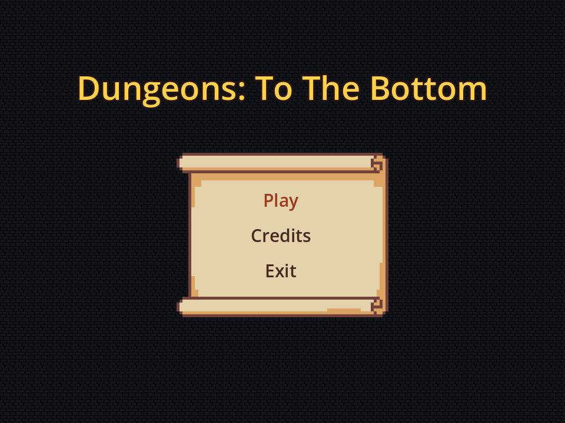
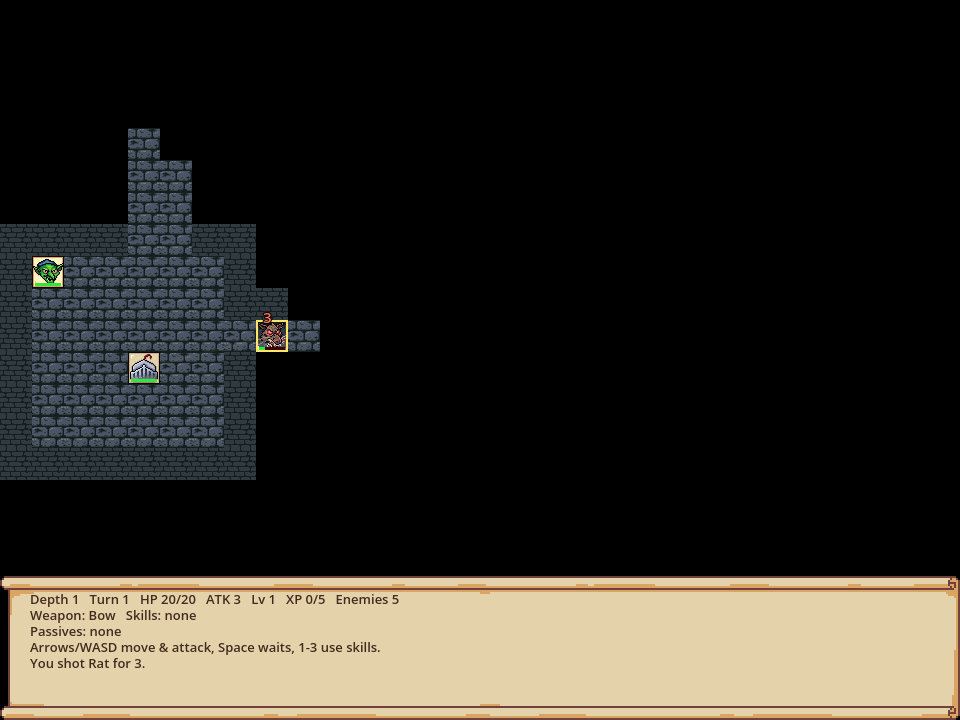
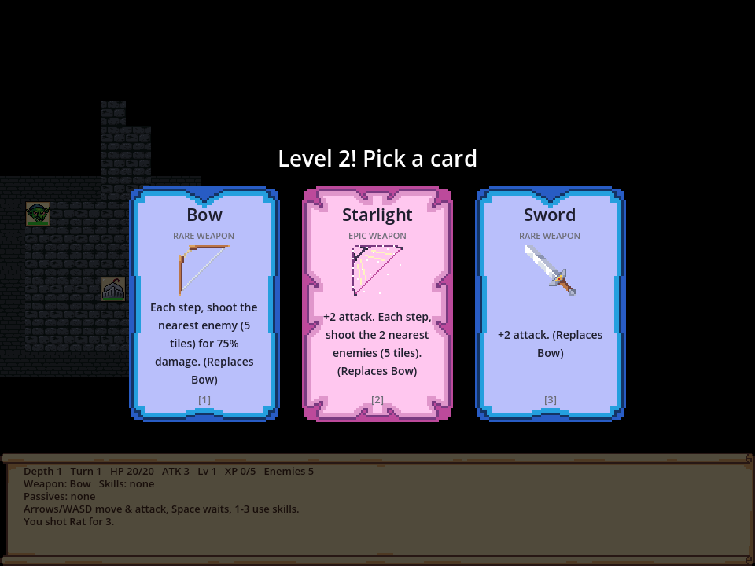

# Dungeons: To The Bottom

A turn-based dungeon crawler made in Godot. Fight your way down an endless dungeon, one floor at a time. Every time you level up, pick 1 of 3 cards (passives, skills or weapons) and build a different hero each run.



**Contents:** [Running the game](#running-the-game) · [How to play](#how-to-play) · [Controls](#controls) · [Enemies](#enemies) · [Cards](#cards) · [Weapons](#weapons) · [Skills](#skills) · [Passives](#passives) · [Adding art](#adding-art) · [For developers](#for-developers) · [Credits](#credits)

---

## Running the game

You need **Godot 4.5 or newer** (we use 4.7). Use the normal version, not the .NET one.

1. Download Godot from [godotengine.org/download](https://godotengine.org/download). It's a single program, so there's no installer.
2. Get the project:
   - **With GitHub Desktop:** File → Clone repository → `rix346/godot`.
   - **Without Git:** on GitHub press **Code → Download ZIP** and unzip it.
3. Open Godot, press **Import**, pick the `project.godot` file in the folder, then **Import & Edit**.
4. Press **Play** (top right):

   | | Run the game | Stop |
   |---|---|---|
   | Mac | ⌘B | ⌘. |
   | Windows / Linux | F5 | F8 |

The game opens on the title screen. Press **Play** to start.

### Getting updates

In GitHub Desktop, press **Fetch origin**, then **Pull origin**. Close Godot before pulling. If a pull complains about an untracked `.import` file, delete that file and pull again.

To try a change before it's merged, go to **Current Branch → Pull Requests**, pick the PR and run the game.

---

## How to play



- **It's turn-based.** Nothing moves until you do. After each of your actions, every enemy takes its turn.
- **Attack by walking into an enemy.**
- **Clear the floor.** When every enemy on a floor is dead, the **stairs** appear. Step on them to go one depth deeper. The dungeon never ends, but each depth has more and stronger enemies (3 + 2 × depth of them).
- **Fog of war.** You see 7 tiles around you, and walls block your view. Places you've already seen stay on the map, darker.
- **Level up.** Kills give XP. Each level-up pauses the game and offers **3 cards**, and you pick one. Each level needs a bit more XP than the last.
- **Dying.** The run is over. Press **R** to start a new one, or **Esc** to go back to the menu.

The bar at the bottom shows depth, turn, HP, attack, level, XP, enemies left, your weapon, skills, passives and the last few combat messages.

You start with **20 HP** and **3 attack**.

---

## Controls

| Key | Action |
|---|---|
| Arrows / WASD | Move. Walk into an enemy to attack it |
| Space or `.` | Wait one turn |
| 1, 2, 3 | Use skill 1-3 |
| Left mouse click on an enemy | Choose the target for a ranged weapon (doesn't use a turn) |
| 1, 2, 3 or click | Pick a card on the level-up screen |
| R | Restart after dying |
| Esc | Back to the title screen |

---

## Enemies

Enemies get stronger the deeper you go: **+2 HP per depth** and **+1 attack every 2 depths**. The table shows their stats at the depth where they first appear.

| Enemy | From depth | HP | Attack | XP | Special |
|---|---|---|---|---|---|
| Rat | 1 | 4 | 1 | 1 | – |
| Bat | 1 | 3 | 1 | 2 | Fast: acts twice per turn |
| Goblin | 1 | 7 | 2 | 2 | – |
| Archer | 2 | 7 | 2 | 3 | Shoots you from up to 5 tiles away in a straight line |
| Orc | 2 | 14 | 3 | 4 | Tough |
| Brute | 3 | 24 | 7 | 8 | Slow: rests every other turn (shows a "z") |
| Wraith | 3 | 13 | 6 | 6 | Hits hard |
| Spider | 3 | 10 | 3 | 4 | **Poison:** its bite deals 1 damage per turn for 3 turns |
| Knight | 5 | 23 | 9 | 10 | The hardest hitter |

Enemies chase you once you're within 7 tiles of them.

---

## Cards

Each level-up offers 3 different cards. How often a card shows up depends on its rarity:

| Rarity | Colour | Chance weight |
|---|---|---|
| Common | Grey | 60 |
| Rare | Blue | 30 |
| Epic | Purple | 10 |
| Legendary | Yellow | 3 |

There are three kinds of card: **weapons**, **skills** and **passives**.



---

## Weapons

You hold **one weapon at a time**. Picking a new one replaces the old one. Without a weapon you fight with your fists.

| Weapon | Rarity | Effect |
|---|---|---|
| Dagger | Common | Strike twice, each for 60% damage |
| Sword | Rare | +2 attack |
| Spear | Rare | +1 attack. Reaches 2 tiles and pierces to the enemy behind |
| Bow | Rare | **Ranged.** Each step, shoots the nearest enemy within 5 tiles for 75% damage |
| Trident | Epic | +2 attack. Also hits the enemies on both sides of your target |
| Mythril Blade | Epic | +4 attack and +20% crit chance |
| Starlight | Epic | **Ranged.** +2 attack. Each step, shoots the 2 nearest enemies within 5 tiles |
| Dragon Slayer | Legendary | +6 attack. Double damage to big enemies (15+ max HP) |
| Excalibur | Legendary | +5 attack. Every attack also hits all enemies around you |

**How ranged weapons work:** every time you **move or wait**, the weapon fires by itself at the closest enemy you can see within 5 tiles (walls block shots). A **yellow box** marks that target. **Left-click** another enemy in range to aim at it instead, and the box turns **red**. You can still walk into enemies for a normal melee hit.

---

## Skills

Skills go in your skill bar (up to **3**) and are used with keys **1-3**. Using one takes a turn, then it goes on cooldown (shown in the HUD). Picking the same skill card again lowers its cooldown by 1 and makes it ready right away.

| Skill | Rarity | Cooldown | Effect |
|---|---|---|---|
| Fireball | Common | 4 | Blasts the nearest enemy within 6 tiles for attack + 3 |
| Whirlwind | Rare | 5 | Hits every enemy around you (8 directions) |
| Mend | Rare | 10 | Restores 40% of max HP |
| Stone Skin | Rare | 9 | Blocks all damage for the next 2 enemy turns |
| Chain Lightning | Epic | 6 | Zaps the nearest enemy, then jumps to 2 more nearby |

---

## Passives

Passives are always on. Most can be picked more than once (max stacks in brackets).

| Passive | Rarity | Effect |
|---|---|---|
| Tough Hide (5) | Common | +5 max HP and heal 5 |
| Sharpened Blade (5) | Common | +1 attack |
| Thorns (3) | Common | Enemies that hit you in melee take 1 damage |
| Keen Eye (3) | Common | +15% chance to deal double damage |
| Quick Study (3) | Common | +25% XP from kills |
| Vampiric Fangs (3) | Rare | Heal 1 HP every time you hit |
| Second Wind (3) | Rare | Regenerate 1 HP every few turns (faster per stack) |
| Iron Skin (3) | Rare | Take 1 less damage from every hit (min 1) |
| Berserker (2) | Rare | +50% damage while below half HP |
| Bloodlust (3) | Epic | Heal 3 HP on every kill |
| Glass Cannon (2) | Epic | +3 attack, but −5 max HP |
| Phoenix Heart (1) | Legendary | The first time you would die, revive with half your HP |
| Titan's Grip (1) | Legendary | +5 attack and +10 max HP |

---

## Adding art

All art lives in [`art/`](art/README.md) and is picked up **by file name**. Drop in a PNG with the right name, open Godot once so it imports, and it shows up in the game. Anything without a file is drawn as a coloured square with a letter.

- Units: `player.png`, and enemies by lowercase name (`rat.png`, `spider.png`, `knight.png`, ...). Size 32×32.
- Tiles: `floor.png`, `wall.png`, `stairs.png`. Add `wall_4.png` and so on to change the look from that depth on.
- Cards: `card_common.png` ... `card_legendary.png` (64×100). Weapon icons: `weapon_<id>.png` (32×32).
- UI: `hud.png` (bottom bar) and `menu_panel.png` (title screen scroll).

The full list is in [art/README.md](art/README.md). **Commit each `.png` together with its `.png.import` file.**

---

## For developers

Written in GDScript. The UI is built in code, so there are only two scenes.

| File | What's in it |
|---|---|
| `scenes/title.tscn`, `scripts/title.gd` | Title screen (Play / Credits / Exit). Credits text is `CREDITS` |
| `scenes/main.tscn`, `scripts/main.gd` | Dungeon generation, fog of war, turn loop, combat, weapons, skills, HUD |
| `scripts/unit.gd` | Shared grid unit: HP, drawing, damage, movement |
| `scripts/player.gd` | XP, levels and the stats cards change |
| `scripts/enemy.gd` | Enemy types (`KINDS`) and depth scaling |
| `scripts/cards.gd` | Every card (`POOL`), offer rules and effects |
| `scripts/level_up_ui.gd` | The 3-card pick screen |
| `tools/sim.gd` | Headless bot that plays random turns (smoke test) |
| `tools/feature_test.gd` | Applies every card and fires every skill on a depth-3 floor |

**Adding an enemy:** add a line to `KINDS` in `scripts/enemy.gd`. The optional keys are `actions`, `range`, `slow` and `poison`.
**Adding a card:** add an entry to `POOL` in `scripts/cards.gd`. Passives go in `apply()`, skills in `_use_skill()` in `main.gd`, and weapons use keys like `atk`, `crit`, `reach`, `ranged`.

Run the tests from the project folder:

```
godot --headless --script res://tools/sim.gd
godot --headless --script res://tools/feature_test.gd
```

The original plan is in [PLAN.md](PLAN.md).

---

## Credits

- **Programmer & Game:** Rihards Strazds
- **Art & Game:** Svjatoslavs Boronins
