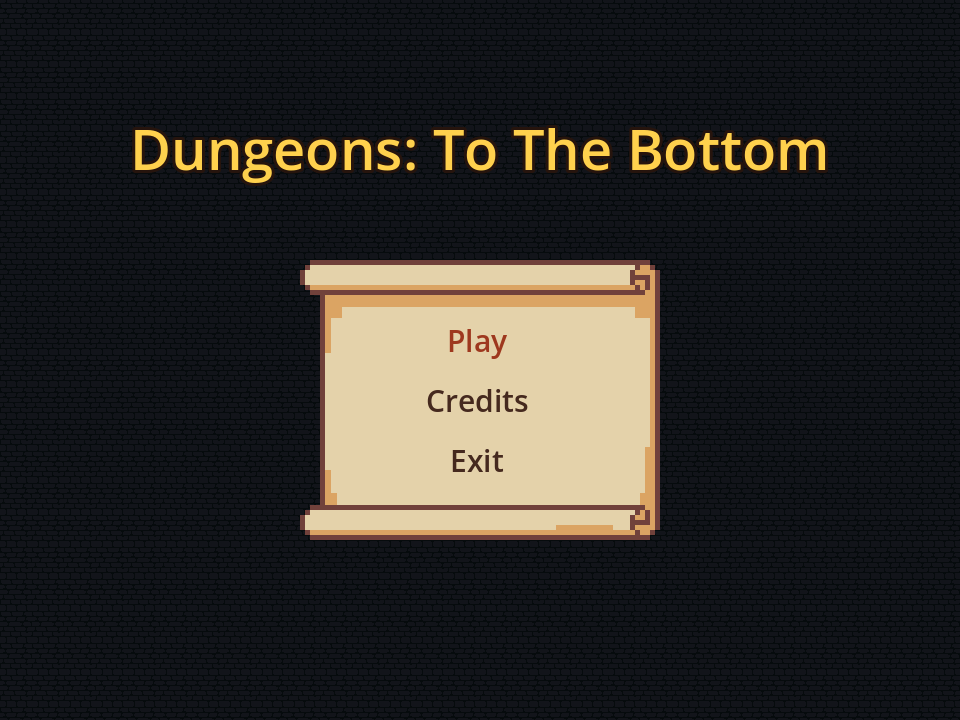
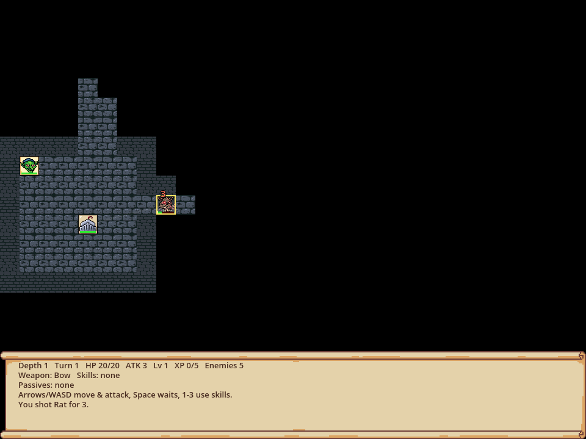
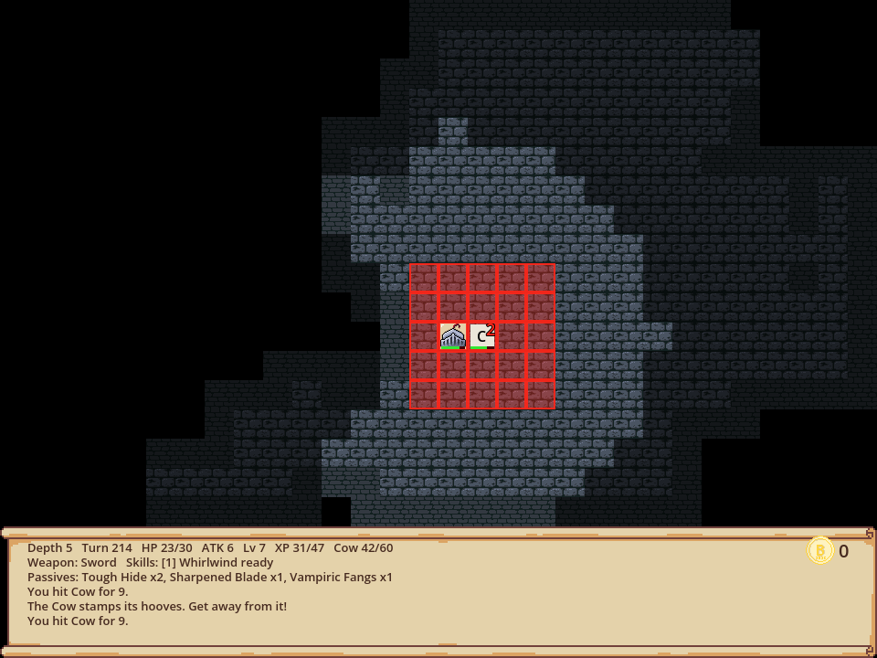
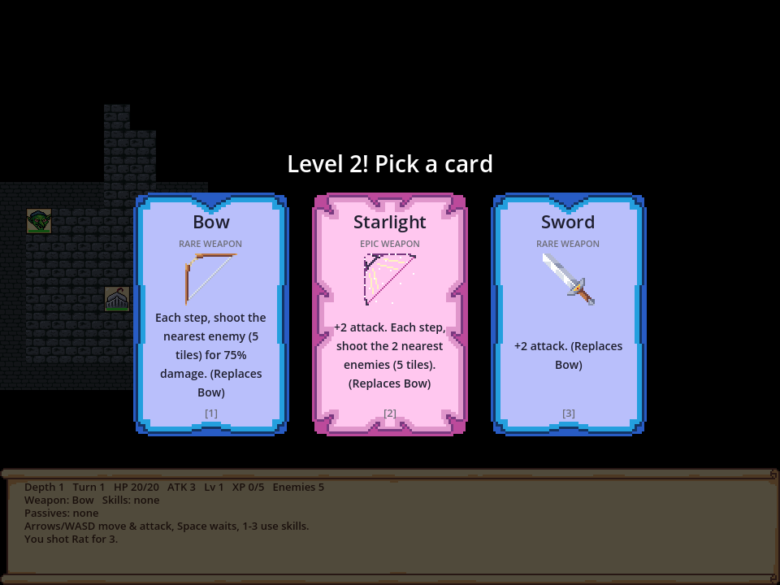

# Dungeons: To The Bottom

A turn-based dungeon crawler made in Godot. Fight your way down an endless dungeon, one floor at a time. Every time you level up, pick 1 of 3 cards (passives, skills or weapons) and build a different hero each run. Collect coins and spend them at the shopkeeper for even more cards, and face a boss every 5 floors.



**Contents:** [Running the game](#running-the-game) · [How to play](#how-to-play) · [Controls](#controls) · [Enemies](#enemies) · [Boss floors](#boss-floors) · [Coins and the shop](#coins-and-the-shop) · [Cards](#cards) · [Weapons](#weapons) · [Skills](#skills) · [Passives](#passives) · [Adding art](#adding-art) · [For developers](#for-developers) · [Credits](#credits)

---

## Running the game

You need **Godot 4.5 or newer** (we use 4.7). Use the normal version, not the .NET one.

1. Download Godot from [godotengine.org/download](https://godotengine.org/download). It's a single program, so there's no installer.
2. Get the project:
   - **With GitHub Desktop:** File → Clone repository → `rix346/godot`.
   - **Without Git:** on GitHub press **Code → Download ZIP** and unzip it.
3. Open Godot, press **Import**, pick the `project.godot` file in the folder, then **Import & Edit**.
4. Press **Play** (top right):

   | | Run the game | Stop |
   |---|---|---|
   | Mac | ⌘B | ⌘. |
   | Windows / Linux | F5 | F8 |

The game opens on the title screen. Press **Play** to start.

### Getting updates

In GitHub Desktop, press **Fetch origin**, then **Pull origin**. Close Godot before pulling. If a pull complains about an untracked `.import` file, delete that file and pull again.

To try a change before it's merged, go to **Current Branch → Pull Requests**, pick the PR and run the game.

---

## How to play



- **It's turn-based.** Nothing moves until you do. After each of your actions, every enemy takes its turn.
- **Attack by walking into an enemy.**
- **Clear the floor.** When every enemy on a floor is dead, the **stairs** appear. Step on them to go one depth deeper, and you **heal 30% of your max HP** on the way down. The dungeon never ends. Each depth has 2 more enemies than the last, up to 20, and after that the enemies just keep getting tougher. See [Enemies](#enemies).
- **Boss floors.** Every 5th depth (5, 10, 15, ...) is a cave with one boss in it, the Cow. See [Boss floors](#boss-floors).
- **Coins and the shop.** Enemies sometimes drop coins. Spend them at the shopkeeper, who shows up on some floors. See [Coins and the shop](#coins-and-the-shop).
- **Fog of war.** You see 7 tiles around you, and walls block your view. Places you've already seen stay on the map, darker.
- **Level up.** Kills give XP. Each level-up pauses the game and offers **3 cards**, and you pick one. Each level needs a bit more XP than the last.
- **Dying.** The run is over and your coins are lost. Press **R** to start a new one, or **Esc** to go back to the menu.

The bar at the bottom shows depth, turn, HP, attack, level, XP, enemies left, your weapon, skills, passives and the last few combat messages. Your coins are in its top-right corner.

You start with **20 HP** and **3 attack**.

---

## Controls

| Key | Action |
|---|---|
| Arrows / WASD | Move. Walk into an enemy to attack it |
| Space or `.` | Wait one turn |
| 1, 2, 3 | Use skill 1-3. Break Wall then asks for a direction (arrows / WASD) |
| Left mouse click on an enemy | Choose the target for a ranged weapon (doesn't use a turn) |
| 1, 2, 3 or click | Pick a card on the level-up screen, or buy one in the shop |
| Walk into the shopkeeper | Open the shop (doesn't use a turn) |
| R | Restart after dying, or reroll the shop's cards (5 coins) |
| Esc | Leave the shop, cancel Break Wall, or go back to the title screen |

---

## Enemies

Enemies get stronger the deeper you go: **+2 HP per depth** and **+1 attack every 2 depths**. The table shows their stats at the depth where they first appear.

| Enemy | From depth | HP | Attack | XP | Coin drop | Special |
|---|---|---|---|---|---|---|
| Rat | 1 | 4 | 1 | 1 | 18% | – |
| Bat | 1 | 3 | 1 | 2 | 26% | Fast: acts twice per turn |
| Goblin | 1 | 7 | 2 | 2 | 26% | – |
| Archer | 2 | 7 | 2 | 3 | 34% | Shoots you from up to 5 tiles away in a straight line |
| Orc | 2 | 14 | 3 | 4 | 42% | Tough |
| Brute | 3 | 24 | 7 | 8 | 74% | Slow: rests every other turn (shows a "z") |
| Wraith | 3 | 13 | 6 | 6 | 58% | Hits hard |
| Spider | 3 | 10 | 3 | 4 | 42% | **Poison:** its bite deals 1 damage per turn for 3 turns |
| Knight | 5 | 23 | 9 | 10 | 90% | The hardest hitter |

Enemies chase you once you're within 7 tiles of them.

### Deeper down

- **Up to 20 enemies a floor.** A floor has 3 + 2 × depth enemies, which reaches 20 on depth 9. Deeper floors don't get more crowded, they get harder.
- **A tougher mix.** On depth 1 every enemy type is about as likely. The deeper you go, the more often the tough types show up and the weak ones fade out. By depth 10 a Knight is 10 times as likely as a Rat.
- **Elites.** From depth 9, some enemies spawn as **elites** with a **gold frame**: 5% of them on depth 9, then 5% more every depth, up to 75%. An elite has **double HP**, **1.5× attack** and gives **double XP**, and it **always drops a coin**. Its name starts with "Elite" in the log.

| Depth | Enemies | Knights, Brutes, Wraiths | Rats, Bats, Goblins | Elites |
|---|---|---|---|---|
| 1 | 5 | – | 100% | – |
| 4 | 11 | 33% | 28% | – |
| 9 | 20 | 57% | 14% | 5% |
| 14 | 20 | 69% | 8% | 30% |
| 19 | 20 | 78% | 4% | 55% |
| 24 | 20 | 85% | 2% | 75% |

---

## Boss floors

Every 5th depth (5, 10, 15, ...) is a **boss floor**: one big cave instead of rooms, drawn with the depth 1 tiles, with a boss and no other enemies. You start in the middle of the cave and the boss is somewhere further in. The bar at the bottom shows the boss's HP instead of the enemy count. Kill it and the stairs appear as usual.



### The Cow

| HP | Attack | XP | Coins |
|---|---|---|---|
| 60 on depth 5, +8 per depth | 4 on depth 5, +1 per depth | 10 × depth | Always drops 5 |

The Cow hits you up close like any enemy, but it only walks toward you every other turn, so it's easy to get away from. Every few turns, when it can see you within 8 tiles, it winds up one of three **big attacks** instead. It marks the tiles the attack will hit first, and does nothing else while it winds up:

| Attack | Warning | What happens | Damage |
|---|---|---|---|
| **Line blast** | The row or column you're standing in turns **red**, and a "!" shows over the Cow | Next turn the red tiles explode. It always picks a line you can step out of | 1.5× its attack |
| **Charge** | An **orange** path from the Cow to where you're heading: one more step the way you just moved, or where you stand if you didn't move | Next turn it dashes along the path. If you're still on it, it stops in front of you and rams you | 2× its attack |
| **Stomp** | The **5×5** area around it turns **red**, with a countdown (3, 2, 1) over the Cow. Only when you're within 2 tiles | It stands still for 3 turns, then the whole area explodes | 2.5× its attack |

After a big attack lands, it fights normally for 2 turns before it can start the next one. Stone Skin blocks the big attacks too.

**Tips:** the charge aims one step ahead of you, so if you keep walking the same way you run straight into it. Step sideways or stand still. The stomp gives you a couple of free hits before you have to get 3 tiles away.

---

## Coins and the shop

**Coins.** When an enemy dies it may drop a coin on its tile. Tougher enemies drop them more often (see the *Coin drop* column above). Walk over a coin to pick it up. Coins still on the floor when you take the stairs are left behind, and **when you die you lose all your coins**. With the **Coin Magnet** passive, coins fly straight to your counter instead.

**The shopkeeper ($).** From depth 2, when you clear a floor a shopkeeper sometimes appears along with the stairs: 40% of the time, and never 3 floors in a row without one. The shopkeeper always stands in an open spot, so they never block a corridor, and they can't be hurt.

Walk into the shopkeeper to open the shop. It has 3 cards for sale, picked the same way as level-up cards. Buy one with **1-3** or a click, and leave with **Esc**. Browsing doesn't use a turn, and you can come back as long as you're on that floor.

Don't like the cards? Press **R** or click **Reroll** to swap all 3 for new ones, for **5 coins** each time. Sold cards get replaced too.

| Rarity | Price |
|---|---|
| Common | 3 coins |
| Rare | 5 coins |
| Epic | 8 coins |
| Legendary | 12 coins |

---

## Cards

Each level-up offers 3 different cards. How often a card shows up depends on its rarity:

| Rarity | Colour | Chance weight |
|---|---|---|
| Common | Grey | 60 |
| Rare | Blue | 30 |
| Epic | Purple | 10 |
| Legendary | Yellow | 3 |

There are three kinds of card: **weapons**, **skills** and **passives**. Once you hold a weapon, a level-up never offers 3 weapons at once, so you're never forced to swap. With your fists, any mix can come up.



---

## Weapons

You hold **one weapon at a time**. Picking a new one replaces the old one. Without a weapon you fight with your fists.

| Weapon | Rarity | Effect |
|---|---|---|
| Dagger | Common | Strike twice, each for 60% damage |
| Sword | Rare | +2 attack |
| Spear | Rare | +1 attack. Reaches 2 tiles and pierces to the enemy behind |
| Bow | Rare | **Ranged.** Each step, shoots the nearest enemy within 5 tiles for 75% damage |
| Trident | Epic | +2 attack. Also hits the enemies on both sides of your target |
| Mythril Blade | Epic | +4 attack and +20% crit chance |
| Starlight | Epic | **Ranged.** +2 attack. Each step, shoots the 2 nearest enemies within 5 tiles |
| Dragon Slayer | Legendary | +6 attack. Double damage to enemies with 15 or more max HP |
| Excalibur | Legendary | +5 attack. Every attack also hits all enemies around you |

**How ranged weapons work:** every time you **move or wait**, the weapon fires by itself at the closest enemy you can see within 5 tiles (walls block shots). A **yellow box** marks that target. **Left-click** another enemy in range to aim at it instead, and the box turns **red**. You can still walk into enemies for a normal melee hit.

---

## Skills

Skills go in your skill bar (up to **3**) and are used with keys **1-3**. Using one takes a turn, then it goes on cooldown (shown in the HUD). Picking the same skill card again lowers its cooldown by 1 and makes it ready right away.

| Skill | Rarity | Cooldown | Effect |
|---|---|---|---|
| Fireball | Common | 4 | Blasts the nearest enemy within 6 tiles for attack + 3 |
| Whirlwind | Rare | 5 | Hits every enemy around you (8 directions) |
| Mend | Rare | 10 | Restores 40% of max HP |
| Stone Skin | Rare | 9 | Blocks all damage for the next 2 enemy turns |
| Chain Lightning | Epic | 6 | Zaps the nearest enemy, then jumps to 2 more nearby |
| Break Wall | Legendary | 4 | Smashes a wall next to you into floor, making a new path. Press its key, then a direction (any other key cancels). The map edge and the 4 corner tiles around each room can't break |

---

## Passives

Passives are always on. Most can be picked more than once (how many times is in brackets).

| Passive | Rarity | Effect |
|---|---|---|
| Tough Hide (no limit) | Common | +5 max HP and heal 5 |
| Sharpened Blade (no limit) | Common | +1 attack |
| Thorns (3) | Common | Enemies that hit you in melee take 1 damage |
| Keen Eye (3) | Common | +15% chance to deal double damage |
| Quick Study (3) | Common | +25% XP from kills |
| Vampiric Fangs (3) | Rare | Heal 1 HP every time you hit |
| Second Wind (3) | Rare | Regenerate 1 HP every few turns (faster per stack) |
| Iron Skin (3) | Rare | Take 1 less damage from every hit (min 1) |
| Berserker (2) | Rare | +50% damage while below half HP |
| Bloodlust (3) | Epic | Heal 3 HP on every kill |
| Glass Cannon (2) | Epic | +3 attack, but −5 max HP |
| Coin Magnet (1) | Epic | Coins fly straight to you instead of dropping on the ground |
| Phoenix Heart (1) | Legendary | The first time you would die, revive with half your HP |
| Titan's Grip (1) | Legendary | +5 attack and +10 max HP |
| Night Vision (1) | Legendary | See the whole floor and every enemy on it. No more fog |

---

## Adding art

All art lives in [`art/`](art/README.md) and is picked up **by file name**. Drop in a PNG with the right name, open Godot once so it imports, and it shows up in the game. Anything without a file is drawn as a coloured square with a letter.

- Units: `player.png`, and enemies by lowercase name (`rat.png`, `spider.png`, `knight.png`, ...). Size 32×32.
- Tiles: `floor.png`, `wall.png`, `stairs.png`. Add `wall_4.png` and so on to change the look from that depth on.
- Cards: `card_common.png` ... `card_legendary.png` (64×100). Weapon icons: `weapon_<id>.png` (32×32).
- UI: `hud.png` (bottom bar) and `menu_panel.png` (title screen scroll).
- Coins and the shop: `coin.png` (32×32, drawn at half size on the floor) and `shopkeeper.png` (32×32).
- Bosses: `cow.png` (32×32). Until it exists, the Cow is a white square with a `C`.

The full list is in [art/README.md](art/README.md). **Commit each `.png` together with its `.png.import` file.**

---

## For developers

Written in GDScript. The UI is built in code, so there are only two scenes.

| File | What's in it |
|---|---|
| `scenes/title.tscn`, `scripts/title.gd` | Title screen (Play / Credits / Exit). Credits text is `CREDITS` |
| `scenes/main.tscn`, `scripts/main.gd` | Dungeon generation (rooms, and caves on boss floors), fog of war, turn loop, combat, weapons, skills, coins, shop, HUD |
| `scripts/unit.gd` | Shared grid unit: HP, drawing, damage, movement |
| `scripts/player.gd` | XP, levels and the stats cards change |
| `scripts/enemy.gd` | Enemy types (`KINDS`), depth scaling, the tougher mix deeper down (`random_kind`) and elites |
| `scripts/cow.gd` | The Cow boss: its stats, its three big attacks and when it uses them |
| `scripts/cards.gd` | Every card (`POOL`), offer rules and effects |
| `scripts/level_up_ui.gd` | The 3-card pick screen |
| `scripts/shop_ui.gd` | The shop screen. Prices are in `PRICES`, the reroll cost in `REROLL_PRICE` |
| `tools/sim.gd` | Headless bot that plays random turns (smoke test) |
| `tools/feature_test.gd` | Checks the coin, shop, Night Vision, Break Wall, enemy cap, elite and boss rules (each of the Cow's attacks), then applies every card and fires every skill on a depth-3 floor |

**Adding an enemy:** add a line to `KINDS` in `scripts/enemy.gd`. The optional keys are `actions`, `range`, `slow` and `poison`.
**Adding a boss:** make a script that extends `scripts/enemy.gd`, like `scripts/cow.gd`, with a `boss_turn(game)` function. `main.gd` calls it instead of the normal enemy turn. Tiles you put in its `danger` list are marked on the map (`danger_color`). Spawn it in `_spawn_boss()` in `main.gd`.
**Adding a card:** add an entry to `POOL` in `scripts/cards.gd`. Passives go in `apply()`, skills in `_use_skill()` in `main.gd`, and weapons use keys like `atk`, `crit`, `reach`, `ranged`.

Run the tests from the project folder:

```
godot --headless --script res://tools/sim.gd
godot --headless --script res://tools/feature_test.gd
```

The original plan is in [PLAN.md](PLAN.md).

---

## Credits

- **Programmer & Game:** Rihards Strazds
- **Art & Game:** Svjatoslavs Boronins
